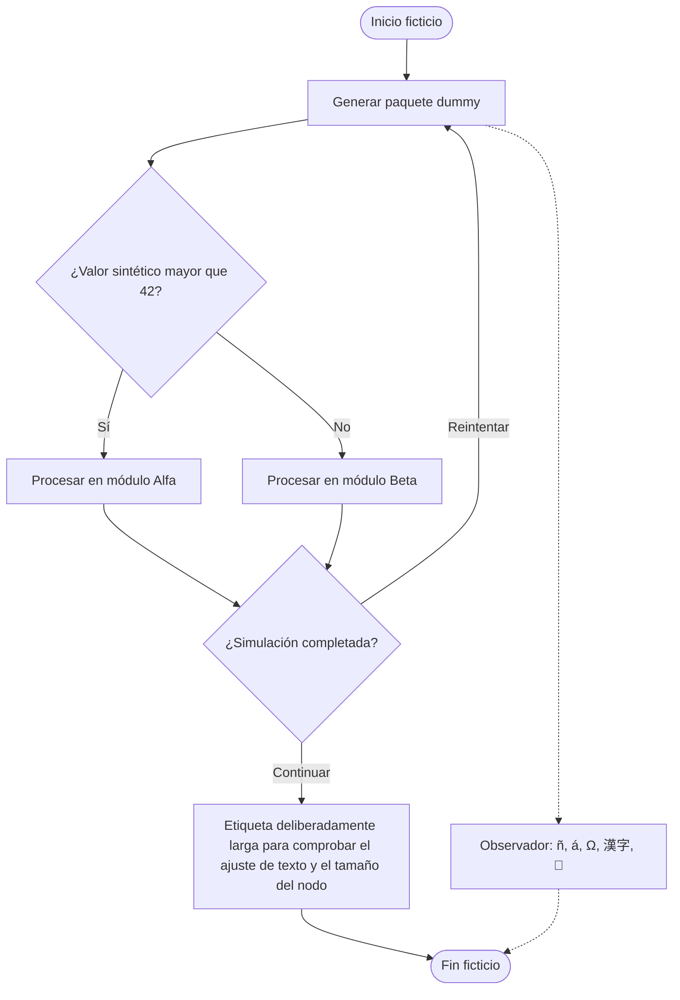
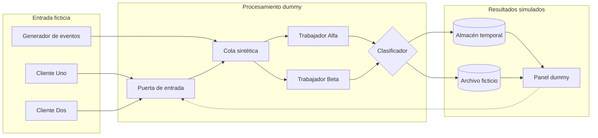
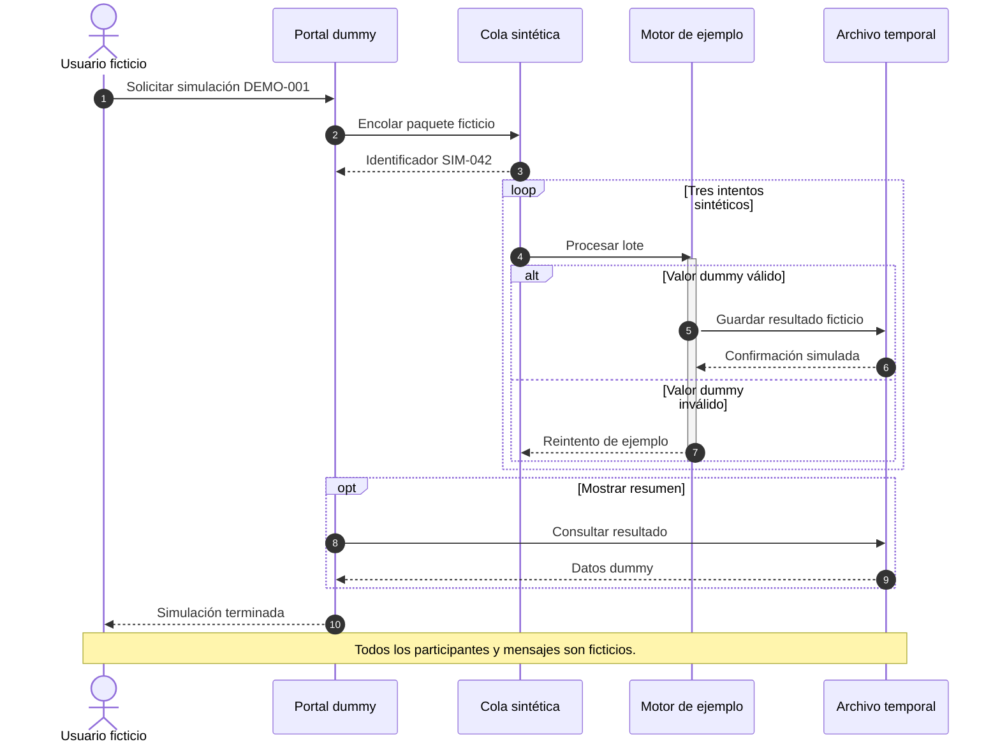
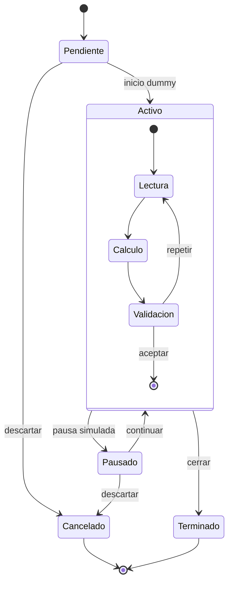
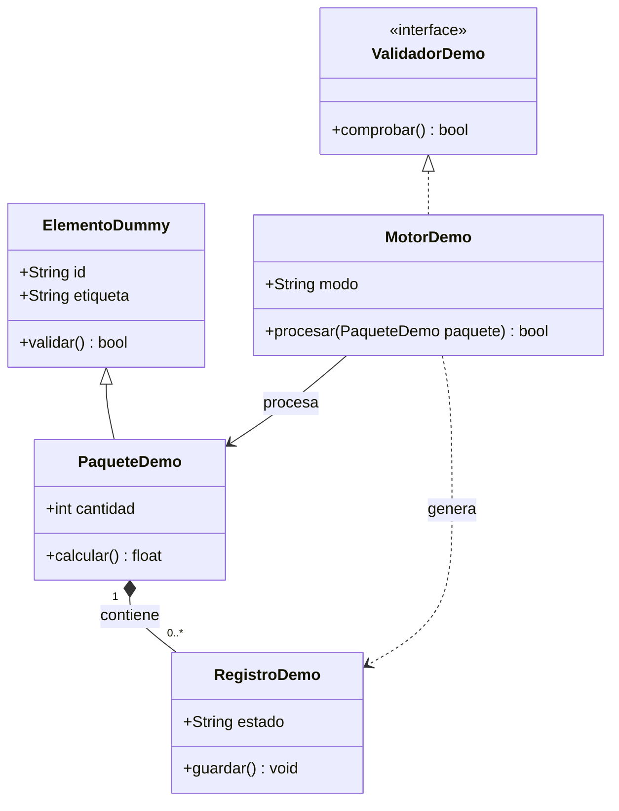
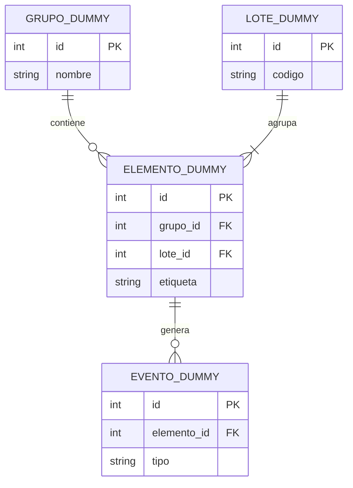
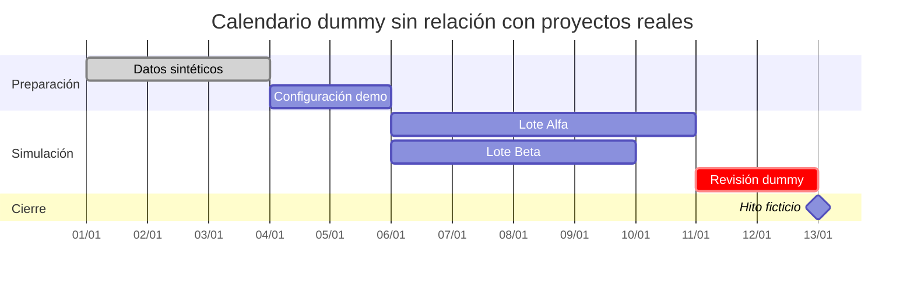
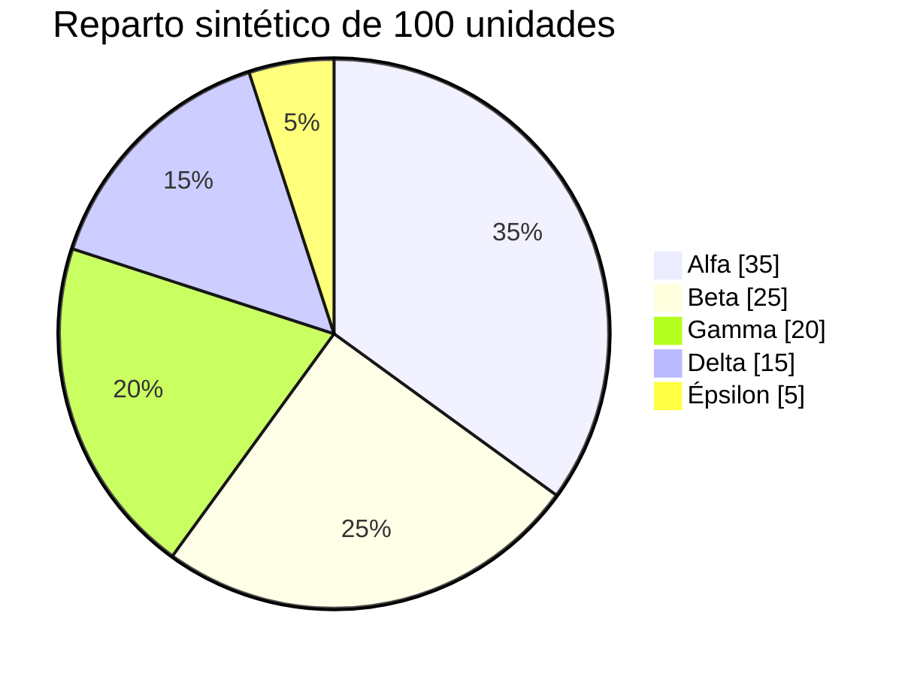
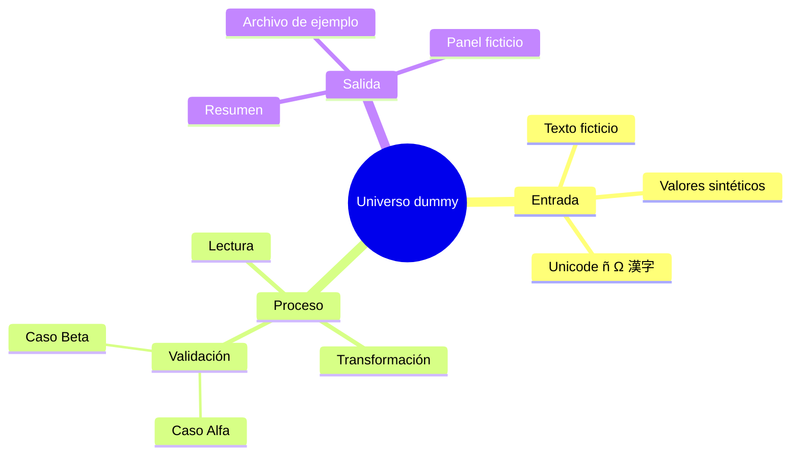
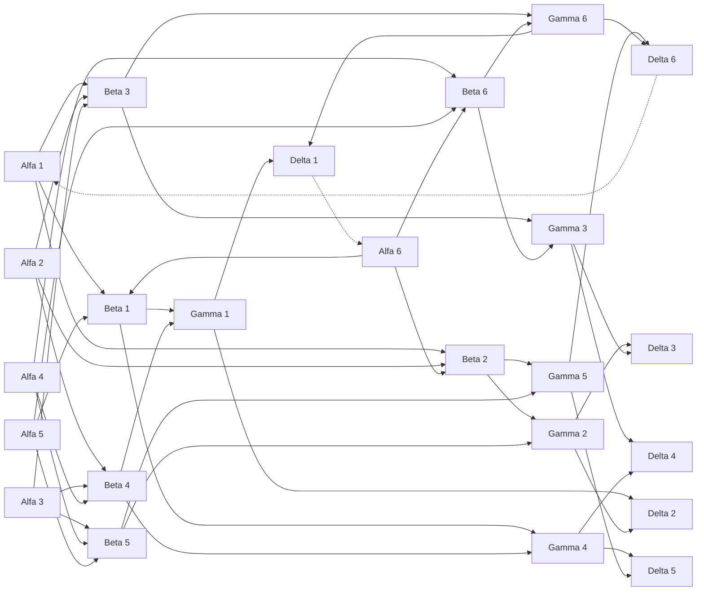

# Prueba de estrés: diagramas Markdown

Todo el contenido es ficticio. Los nombres, valores, fechas y relaciones son datos dummy.

Este documento prueba bloques Mermaid, diagramas de texto, etiquetas largas, Unicode, ciclos, relaciones y orientación. Requiere un visor Markdown con soporte Mermaid para los bloques gráficos. Algunos tipos dependen de la versión del visor.

## 1. Flujo con decisiones, ciclos y etiquetas largas



## 2. Arquitectura con subgrafos



## 3. Secuencia con bucle y alternativas



## 4. Máquina de estados



## 5. Diagrama de clases



## 6. Entidades y relaciones



## 7. Cronograma ficticio



## 8. Distribución de valores dummy



## 9. Mapa mental



## 10. Grafo denso: 24 nodos y enlaces cruzados



## 11. Diagrama monoespaciado sin extensiones

```text
┌───────────────────────┐      ┌───────────────────────┐
│ Entrada dummy         │─────▶│ Transformación demo   │
│ α = 12; β = 34        │      │ etiqueta: SIM-042     │
└───────────────────────┘      └───────────┬───────────┘
                                          │
                              ┌───────────▼───────────┐
                              │ Salida ficticia       │
                              │ resultado: 46         │
                              └───────────────────────┘
```

## Criterios de revisión visual

- Los bloques Mermaid se convierten en gráficos si el visor los admite.
- Las etiquetas largas y los caracteres Unicode permanecen legibles.
- Los enlaces, ciclos y cardinalidades no desaparecen.
- Los diagramas anchos admiten desplazamiento o ajuste sin recortar contenido.
- El diagrama de texto conserva espacios, bordes y alineación.
- La página sigue respondiendo al desplazamiento con todos los bloques visibles.
